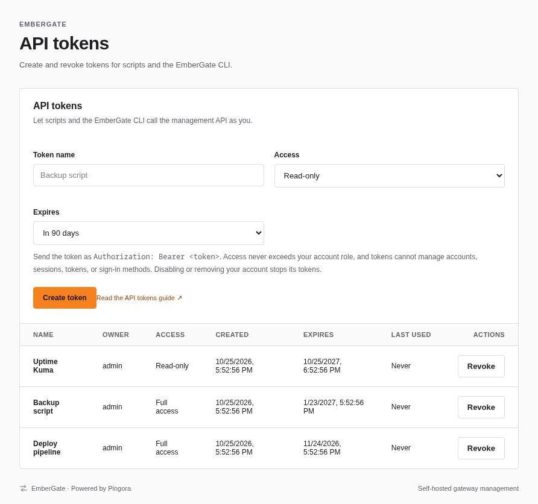
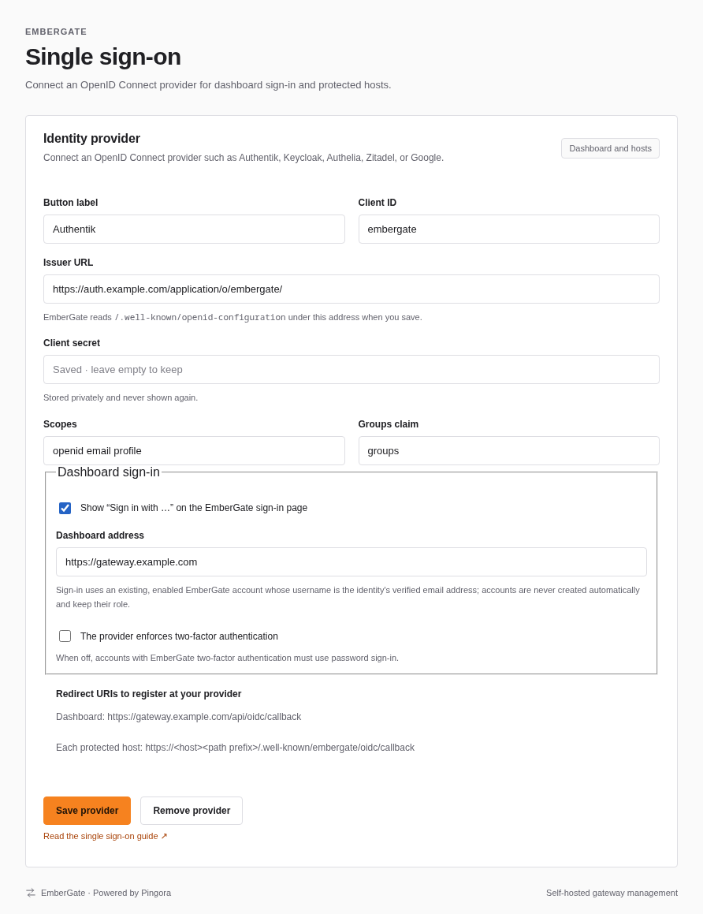
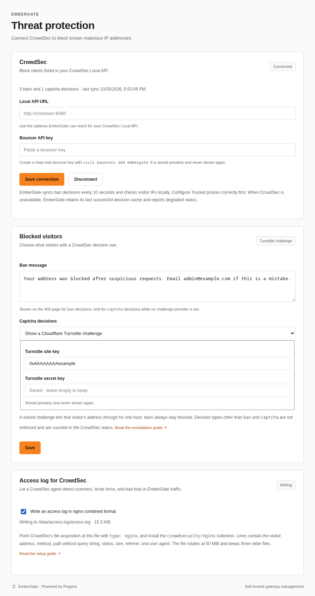

# Settings, accounts, and backups

[Documentation index](README.md) · [EmberGate overview](../README.md)

## Settings navigation

Click **Settings** in the main sidebar to open a second navigation panel beside it. Each option shows its own page: **Instance details**, **Instances**, **Sign-in methods**, **API tokens**, **Single sign-on**, **DNS provider**, **Threat protection**, **Trusted proxies**, **Host templates**, **Route import / export**, **Configuration history**, and **Backups**. Password and authenticator controls share the security page. Only the selected section is shown, and the last selected section is remembered while using the dashboard.

On smaller screens, the second panel becomes a **Settings section** dropdown above the selected page. Administrator-only sections are excluded for read-only accounts; existing read-only controls and API permissions still apply. Opening an unavailable administrator section redirects to Instance details.

Pages have bookmarkable URLs such as `http://127.0.0.1:9090/#/settings/cloudflare`, `#/settings/security`, and `#/settings/backups`. Reloading, browser Back/Forward, and opening a settings link in another tab retain the selected section after sign-in. Ordinary dialog requests are cancelled when leaving their page; authentication dialogs preserve their recovery-code acknowledgement requirements.
## Help & documentation

Open **Help & documentation** in the sidebar to read the guides included with your installed EmberGate version. All signed-in accounts can read all eight topics: Getting started, Proxy hosts, Certificates, Security, Settings & configuration, Backups & restore, Monitoring, and Troubleshooting. Reading a guide does not grant permission to change the settings it describes.

Search matches words across guide titles and content. Select a result to open the guide, or clear the search to return to the current page. On desktop, use the topic sidebar; smaller screens have a guide dropdown. **On this page** links jump to sections. Topics and sections have bookmarkable URLs such as `#/help/certificates/automatic-certificates-with-cloudflare-dns`; reload and browser Back/Forward retain your place.

**Read guide** links beside DNS provider credentials, trusted proxies, MFA, and backups open the relevant section. Caching and compression guide links in the host editor open a new tab to preserve the current draft. Guides follow the dashboard theme and need no external documentation service or internet connection to read. External reference links still require internet access.

The guides are read-only and built into the binary from the repository's Markdown files in `docs/`. Updating them requires rebuilding and restarting EmberGate. They contain product documentation rather than installation secrets or live configuration. The [public documentation website](https://embergate.niftyisle1.chatgpt.site/#/help/getting-started) uses the same source material.

## Host templates and duplication

Use the **Duplicate** icon on a host row to open an independent copy in the editor. The copy gets a new UUID, a blank hostname, and a paused status. Enter a different hostname or path and review it before saving. The upstream pool, weights, drain flags, maintenance page settings, and all host policies are copied; the source is unchanged. Nothing is saved until **Save host**. A duplicate uses the normal version/conflict checks and configuration history. Enable the new host when ready.

Open **Settings → Host templates → Create template** as an administrator, enter a unique name and optional description, then choose a saved source host. Templates include compression, caching, IP access rules, HTTPS/response headers, rate limiting, timeouts/failover, request rewriting/headers, health checks, Preserve Host, and branded gateway errors. They exclude host identity, match hostname/path, enabled status, upstream origins, balancing weights/drain flags, maintenance state/page text, certificates, global trusted proxies, and credentials. Unsaved changes in a host editor are excluded.

The library shows each template's policies, last editor, and update time. **Edit** can rename it or replace its policy copy from another saved host; leave **Copy policies from** on **Keep saved policies** for a metadata-only change. Source configuration and template-library versions are checked when saving. If another session changes them, close and reopen the form before trying again. Deleting or updating a template leaves existing hosts unchanged.

In the add or duplicate host dialog, the preset picker is on the first step; when editing a host, choose **Apply a preset…** in the section bar first. Choose a template under **Your host templates** in **Start from a preset** and select **Apply to draft**. That group appears once templates exist. Review the policy values and confirm **Apply to draft**. All reusable policy fields are replaced, including clearing fields that are absent in the template. Identity, enabled status, upstream origins/weights/drain flags, and maintenance settings stay as entered. Review the draft and select **Create host** or **Save changes** to make it live. Templates are independent copies, with no ongoing inheritance or synchronization.

Up to **50 templates** are stored within **2 MiB** in **data/host-templates.json**, atomically replaced with Unix permissions 0600. The library is administrator-only and may contain custom policy headers. Full encrypted backups include and validate it; restore reviews show the template count. Restoring an older backup without templates clears a newer library. Route-only exports and configuration-history rollback cover saved host policy copies, without changing the template library.

The administrator API is `GET /api/host-templates`, `POST /api/host-templates`, and `DELETE /api/host-templates/{id}` with the normal session/CSRF header. POST accepts `name`, optional `description`, `expected_version` (library version), optional `id` to edit, and `source_route_id` plus `expected_config_version` to copy saved policies. A new template requires a source; edits may omit it to keep policies. DELETE requires JSON `{"expected_version": <library version>}`. Stale versions return 409. Writes pause while a complete restore is queued. These operations do not change the active route configuration.
## Configuration history

Administrators can open **Settings → Configuration history** to compare an earlier revision with the live configuration. Open a changed host to see the current and proposed values for each changed field. Added/removed hosts, trusted proxy changes, and host ordering are also shown. **Confirm rollback** replaces the complete route and trusted-proxy configuration immediately as a new, increasing revision. The previous configuration is retained, and the audit trail records the rollback source. If the configuration changed after the comparison, close the review and compare again.

History starts with configuration saves after upgrading. Each save archives the configuration that was active before replacing it, including revision 0 on a new installation. The table's time and username identify when a revision was archived and who replaced it, rather than its original creation time or author. Up to **50 earlier configurations** are retained within **32 MiB**; older entries are removed first. A failed save can retain a snapshot of the still-active configuration, but never records the failed candidate as active. The current configuration is omitted from the earlier-revision table.

Revisions live in **data/configuration-history.json**, atomically replaced with Unix permissions 0600. They can contain old hostnames, upstreams, policies, and custom headers, so listing, comparison, and rollback require an administrator. Damaged history blocks configuration saves until repaired instead of silently discarding earlier revisions. Certificates, accounts, credentials, analytics, and listener settings use their own management controls and are unaffected by route rollback.

Full encrypted backups include retained revisions and validate their contents and hashes. Older backups without a history file remain supported; restoring one clears the newer history. Route-only JSON exports contain the selected current configuration, without earlier revisions. Restore previews show the number of included revisions.

The administrator API is `GET /api/config/history`, `GET /api/config/history/{id}`, and `POST /api/config/history/{id}/rollback` with JSON `{"expected_version": <version returned by comparison>, "confirm": "ROLLBACK"}` and the normal session/CSRF header. Revision IDs are content hashes; a pruned revision returns 404, and an outdated comparison returns 409. Configuration writes pause while a full restore is queued.
## Configuration

| Variable | Default | Purpose |
| --- | --- | --- |
| `GATEWAY_ADMIN_PASSWORD` | Unset | Optional recovery override; at least 12 characters, at most 1024 UTF-8 bytes |
| `GATEWAY_ADMIN_ADDR` | `127.0.0.1:9090` | Management listen address |
| `GATEWAY_PROXY_ADDR` | `127.0.0.1:8080` | Client HTTP listen address |
| `GATEWAY_HTTPS_ADDR` | Disabled | Optional client HTTPS listen address, for example `127.0.0.1:8443` |
| `GATEWAY_DATA_DIR` | `data` relative to working directory | Configuration storage |
| `GATEWAY_SECURE_COOKIE` | `false` | Set to `true` when accessing the dashboard through HTTPS |
| `GATEWAY_CLOUDFLARE_API_TOKEN` | Unset | Optional Cloudflare token; overrides any provider saved in Settings |
| `GATEWAY_CLOUDFLARE_API_TOKEN_FILE` | Unset | Read the token from a secret file instead |
| `GATEWAY_DNS_PROPAGATION_TIMEOUT` | `300` | DNS propagation wait in seconds, from 5 to 1800 |
| `RUST_LOG` | Logging library default | Use `info` for application logs |

`routes.json` holds the active configuration. Each save writes `routes.previous.json` before replacing the active file. Invalid saves and stale revisions leave active routes intact. Invalid configuration on startup fails startup. Only run one gateway process per data directory.

Exact hostnames take priority over the `*` fallback. Within a hostname, the longest matching literal path prefix wins. `/api` also matches `/apiv2`; use `/api/` for slash-bounded routes. Paths and queries are forwarded unchanged. By default the upstream Host header follows its URL; enable "Preserve the incoming Host header" when the upstream needs the public hostname. Upstream TLS uses the upstream URL hostname for SNI and certificate verification. DNS is resolved per request and uses the first returned address.

Management listens locally by default. If you access it remotely, place it behind HTTPS and enable secure cookies. Richer cache variation policies are future work. Sessions, token budgets, overview counters, and the overview minute chart reset on restart. Analytics history and recent request logs persist locally; logs omit query strings. Average latency covers full request completion; the server error rate counts 5xx responses. Counters cover all requests through the proxy, including unmatched hosts. Forwarding headers are rebuilt using the verified client IP and protocol. Upstream-facing CF-Connecting-IP, CF-Connecting-IPv6, True-Client-IP, and incoming X-Real-IP values are removed; X-Forwarded-For and X-Real-IP contain the verified visitor address.
## Scheduled encrypted backups

Open **Settings → Backups** and find **Automatic backups**. Choose an interval of **1–168 hours** and retain **1–30 local backups**, open **Encryption passphrase**, enter and confirm a passphrase of at least 12 characters, enable the schedule, and save. Saving starts the next interval; **Back up now** queues an immediate snapshot using the saved settings, even if the automatic schedule is disabled. The gateway runs the scheduler itself; the browser can be closed. A missed interval runs once after restart, without replaying every missed interval.

Automatic files use the same encrypted `.embergate` full-backup format and size limits as manual exports. They include routes, accounts, certificates and private keys, saved credentials, MFA, analytics, audit history, and alert state. Files are stored in **data/.embergate-backups/scheduled/** (0700 directory, 0600 files on Unix). After a new encrypted file is safely saved, retention removes older owned files while preserving the new copy. Unrelated files are left alone. The **Saved backups** table supports restore, download, and confirmed removal. **Restore…** uses the same passphrase check and review as an uploaded file.

For unattended encryption, EmberGate saves the automation passphrase **unencrypted in its private management database**, as it already does for credentials that must be retrievable. Protect the data directory and keep a separate copy of the passphrase. Exported snapshots, including previous-state recovery exports, deliberately omit this passphrase and rebuild the copied database to remove obsolete values from free SQLite pages. Restoring a snapshot therefore requires re-entering an automation passphrase before scheduled backups resume. Schedule settings, offsite credentials, and recent scheduler state are included; queued/running jobs are cleared from exports. The local archive collection is not included recursively. A local pre-restore recovery directory still contains the previous private database and must be protected accordingly.

Replacing the passphrase affects future archives; older archives still require their original passphrase. **Forget the saved passphrase and disable this schedule** removes the saved credential. Saved secrets are never returned by the schedule API, account lists, or audit records. Normal backups continue to include all other supported credentials. Manual exports can use their own passphrase.

For an optional offsite copy, open **Offsite copy**, enable uploading, and provide an existing **HTTPS / WebDAV folder URL ending in /**. The destination must support [HTTP PUT](https://www.rfc-editor.org/rfc/rfc4918.html#section-9.7). Choose no authentication, a bearer token, or Basic authentication with a username and password/app password. The server appends a unique archive filename and uploads only encrypted bytes. It does not create folders, follow redirects, or use environment HTTP proxies. Uploads have a 10-second connect limit and a 30-second total limit. HTTP is accepted only for loopback fixtures. URL credentials, queries, fragments, and URLs longer than 2048 bytes are rejected; changing a destination requires explicitly selecting its authentication again. The UI shows the saved destination's origin, never its private path or credentials. Configure remote retention with your storage provider; EmberGate's retention only removes local files.

A failed offsite upload keeps the local encrypted backup. The status distinguishes the latest local copy from the last fully successful local/offsite run. Failed enabled schedules retry after five minutes. Interrupted runs get a one-minute retry deadline after restart. Scheduled jobs defer to an existing backup operation, and new automatic work pauses while a full restore is queued. Settings and local deletions are blocked while a scheduled job is running; configuration/account edits can continue during uploads. Saving settings cancels a queued run, but cannot change an active one. An upload already in progress may finish before a queued restore is applied.

Enable **Show failure alerts and send through enabled notifications** to report failures in **Alerts**. Notifications use the existing opt-in Discord/generic webhook destination and delivery queue. An open failure remains open during a retry and resolves after success. Backup actions and system runs are audited without passphrases, destination paths, upload credentials, or response bodies. Schedule management, file downloads, and removals require an administrator session and honor MFA. Mutations also require `X-Gateway-Request: 1`.

The endpoints are **GET/PUT /api/backups/schedule**, **POST /api/backups/schedule/run**, and **GET/DELETE /api/backups/scheduled/{name}**. Settings updates use their own revision number. The scheduler checks for due work every five seconds; queued work may take a few seconds to begin. No additional database service is required.
## Accounts and audit trail

Open **Accounts** to add up to 50 managed accounts. Usernames use 3–64 letters, digits, dots, underscores, hyphens, `@`, or `+`, so an email address works, and are normalized to lowercase. Passwords require at least 12 characters (at most 1024 UTF-8 bytes). Each account has one role:

| Role | Access |
| --- | --- |
| Administrator | View and change proxy configuration, certificates, caches, accounts, alert preferences, and all sessions; view the audit trail. |
| Read-only | View gateway status, configuration, certificates, analytics, logs, and alerts; manage its own password and two-factor authentication, and revoke its own sessions. |

The reserved **admin** primary administrator cannot be renamed, disabled, or removed. Set its password on the first-run setup screen; afterward, change it in **Settings → Your password** or **Accounts → Change my password**. Managed users can change their own passwords through the same controls. Password changes require the current password and sign out all sessions for that account. An active **GATEWAY_ADMIN_PASSWORD** recovery override takes precedence over the saved admin password and disables web password changes; removing it restores the saved credential. API login requests still default to admin; enrolled accounts also require an authentication or recovery code.

Accounts, Argon2 hashes, and saved DNS credentials persist in **management.sqlite3**, with Unix permissions 0600 and SQLite WAL/full synchronous transactions. Account lists never return hashes. Route exports do not include accounts or management history; use the encrypted full backup feature or a stopped-process data-directory backup.

Sessions last 12 hours and reset on restart. Account edits, disabling, deletion, and password changes revoke all that account's sessions; an already-running request may still finish. Session lists return a separate revocation identifier, never the authentication cookie. Login attempts are limited to 20 per minute per management socket IP; forwarded visitor headers do not affect this limit. People sharing a management proxy IP share its login budget.

**Audit trail** shows the latest 200 management events, retained for 90 days or 10,000 entries. It records actor, socket peer, method, path, target identifier where available, success/failure, and configuration revisions with up to 25 changed route identifiers. Passwords, keys, request bodies, cookies, and query strings are excluded. Login outcomes and rejected authenticated writes are included. Mutations reserve a durable pending entry before running; unavailable audit storage blocks changes with 503 (logout remains available). If completion storage fails or the process stops during a change, the pending entry remains for review; it does not prove whether the change committed. Completion failure also returns **X-Gateway-Audit-Pending: 1**.
## Two-factor authentication

Open **Settings → Two-factor authentication → Set up authenticator**. Confirm your current password, add a time-based EmberGate account to your authenticator using the displayed setup key, and enter its six-digit code. Enrollment expires after ten minutes and is bound to your session. EmberGate uses [RFC 6238 TOTP](https://www.rfc-editor.org/rfc/rfc6238) with SHA-1, six digits, and a 30-second period; keep the gateway and authenticator clocks synchronized. A one-step clock tolerance is accepted, but a used time step cannot be reused.

Save or download the **ten recovery codes** shown after enrollment. Each contains 128 bits of random data, works once, and is stored only as a SHA-256 hash. Codes are never shown again. **Replace recovery codes** revokes all previous codes and requires your password plus an unused authentication/recovery code. **Disable** requires the same proof. Enrollment, replacement, and disabling revoke other sessions for your account; your current session remains available. Read-only accounts can manage their own authenticator.

Administrators who have enrolled can use **Change administrator policy** to require two-factor authentication for every administrator. Changing the policy requires your password and an unused authentication/recovery code. Existing and new administrators who have not enrolled can access only enrollment, session identity, and logout until setup is complete. An administrator cannot disable their factor while enforcement is enabled. The optional **GATEWAY_ADMIN_PASSWORD** override changes the password only; it does not bypass an enrolled authenticator or the enforcement policy. Keep recovery codes outside the gateway.

Sign-in accepts an authenticator or recovery code after password verification. API clients send `code` alongside `username` and `password` to **POST /api/login**. There is no authenticated session before both factors succeed. Factor attempts share the management socket-IP budget and have an additional per-account limit of 20 per minute. A code used to finish enrollment cannot immediately be reused for login or another sensitive action; wait for a new code or use a recovery code.

Authenticator secrets must remain retrievable to verify TOTP and use the same private, unencrypted local database storage model as other saved credentials. Full encrypted backups include authenticator secrets, recovery-code hashes, replay state, and the enforcement policy; route-only exports exclude them. Restoring an older backup also restores that older authentication state, so replace recovery codes after a rollback. Setup keys, codes, and passwords are excluded from audit records, account lists, and backup reviews. This feature protects EmberGate dashboard accounts. See [Passkeys](#passkeys) for device-based sign-in and [Application login protection](proxy.md#application-login-protection) for protecting proxied applications.
## Full backup and restore

Open **Settings → Backups** as an administrator. **Create encrypted backup** downloads an `.embergate` file after you choose and confirm a passphrase of at least 12 characters (up to 1024 UTF-8 bytes). Keep the passphrase separately; it is not stored and cannot be recovered. Backups include:

- Routes, retained configuration history and the previous saved revision when available, trusted proxies, host templates, and every proxy policy.
- Accounts and Argon2 password hashes.
- Certificates, private keys, managed-certificate/DNS recovery state, and saved ACME account credentials.
- DNS provider credentials, notification destinations/preferences, and Prometheus scrape-token hashes.
- Analytics databases, audit history, alerts, and notification delivery history.

Live exports snapshot SQLite through its backup API rather than copying a database while WAL writes are active. Route/certificate changes and ACME state are coordinated during capture; busy certificate issuance/DNS cleanup returns a retry message. Analytics remains live and its database is independently consistent at its snapshot point. The active administrator password hash and Cloudflare/webhook environment credential overrides are materialized into the encrypted snapshot, without changing the live database. Listener addresses, server environment settings, custom CA-root files, memory caches, rate budgets, metrics, and sessions are not archived.

The file uses AES-256-GCM with random salt/nonce and PBKDF2-HMAC-SHA256 (600,000 iterations). The header is authenticated. It is a versioned encrypted container of fixed-name files, with no compressed archive extraction or user-selected filesystem paths. Limits are **64 MiB** of decoded persistent data, **96 MiB** for the encrypted file, and at most 100 saved ACME account files. The app supports its current database schema; incompatible schemas are rejected. Use a stopped-process filesystem backup for installations beyond these limits.

To restore:

1. Choose **Restore backup**, select the file, and enter its passphrase.
2. Review the routes, accounts, certificate validity/domains, managed certificates, credential types, and current environment overrides. Validation checks authenticated encryption, required/unique fixed filenames, SQLite schema/integrity, account hash bounds, route policies, certificates/keys, and ACME credentials/recovery records. It does not replace current data.
3. Type **RESTORE** and select **Queue restore for restart**. The review is bound to your session, expires after 15 minutes, and becomes stale after another successful management edit. Current outstanding DNS cleanup must finish before queueing a replacement. At most five reviews are staged; a new review from the same session replaces its previous review.
4. Restart EmberGate using your usual launch method (or `docker compose restart gateway`). Restore applies before databases/listeners open. All sessions end; sign in with an account/password from the backup and its authenticator or recovery code if enrolled. Current environment overrides still take precedence.

While queued, management edits and new certificate/alert automation pause. Proxy traffic continues, including cached responses; work already in flight may finish. **Cancel queued restore** resumes normal management without replacing data. Backups can still be downloaded while a restore is queued. Uploaded review data, temporary snapshots, and recovery copies use private directories (0700) and files (0600 on Unix); staged plaintext contains the same sensitive material as the private data directory. Expired reviews are cleaned up during later backup operations.

Before replacement, startup saves a consistent local recovery copy under the data directory and writes a durable restore journal. An interruption during replacement resumes the same replacement on the next start; the server does not start with partial data. A committed receipt makes marker cleanup idempotent. A data-directory process lock prevents a second EmberGate instance from restoring over a live process. A validation or filesystem failure stops startup for repair, retaining the journal and recovery data. Restore records a success event in the restored audit database; existing queued notification sends are cancelled to avoid replaying old messages. Saved notification preferences and certificate automation resume afterward.

After a successful restore, **Download previous state** exports the recovery copy as another passphrase-encrypted backup. Validate/review/queue that backup to restore the previous saved installation. Recovery preserves the previous saved data; external environment settings remain managed separately. Recovery snapshots are retained locally; protect this directory and retain a separate downloaded backup. The review never displays hashes, tokens, private keys, DNS challenge values, or passphrases. Read-only accounts cannot access full backup endpoints.

Existing **Export configuration / Choose JSON file** controls remain route-only operations. See [ROADMAP.md](../ROADMAP.md): the product features are implemented; remaining release validation is tracked there. Slack notifications are outside the current scope.

## Passkeys

Open **Settings → Sign-in methods → Passkeys**. An administrator first configures the stable dashboard origin, for example `https://gateway.example.com`. Use an HTTPS origin with no path, query, or credentials. For local use, `http://localhost:9090` is supported; open localhost rather than 127.0.0.1 when registering and signing in. Passkeys are tied to this origin and its hostname. The server pins that origin instead of trusting a visitor-supplied Host header.

Choose **Add passkey**, name the device, confirm your password, and provide an authenticator/recovery code if TOTP is enabled. Follow the browser's device PIN, biometric, or security-key prompt. Up to 16 passkeys can be registered per account. Both administrator and read-only accounts manage their own devices; only administrators can configure the origin. Remove every registered passkey before changing the origin. A new registration invalidates the account's other sessions.

At sign-in, enter your username and choose **Sign in with a passkey**. WebAuthn user verification is required, and signatures, origin/RP binding, challenges, and credential counters/backup state are verified by webauthn-rs. Ceremonies expire after five minutes, remain on the server, and can be consumed only once. Sign-in challenges are additionally bound to the browser through a short-lived HttpOnly cookie. No password is sent during passkey sign-in.

Password sign-in remains available, with an authenticator or unused recovery code when TOTP is enabled. The existing administrator-enforcement policy still requires authenticator enrollment; registering a passkey does not remove that recovery requirement. A verified passkey can sign in without separately typing a TOTP code once enrollment is complete. Keep your password and authenticator recovery codes available if you lose a device.

**Remove** requires your password and an authenticator/recovery code when enabled, then signs out the account's existing sessions. Disabling or deleting an account prevents its passkeys from signing in; deleting an account removes its passkey records. An administrator can disable a compromised account in Accounts. Sign-in attempts are rate limited and successful/failed verified ceremonies are audited without storing assertions or challenges in the audit trail.

Passkey public credentials and the configured origin are included in encrypted full backups. A restored backup needs the same origin to use its passkeys; existing sessions and pending ceremonies are not restored. The passkey's private key stays with its authenticator. While a full restore is queued, passkey sign-in cannot update credential state; use password sign-in or restart to finish the restore.

## API tokens

API tokens let scripts, monitoring jobs, and the EmberGate CLI call the management API without a browser session. Open **Settings → API tokens**, enter a name you will recognize later, choose the access level and expiry, and select **Create token**. Copy the token right away: it is shown once and cannot be retrieved later. Leaving the page clears it from the screen.



Send the token in the `Authorization` header:

```sh
curl -H "Authorization: Bearer eg_…" http://127.0.0.1:9090/api/config
```

- **Access:** **Read-only** tokens can only read. **Full access** tokens can do what your account can do; read-only accounts can create read-only tokens only. Access never exceeds your account's current role, so lowering the role or disabling the account takes effect on the next request. Deleting an account removes its tokens.
- **Limits:** tokens cannot manage accounts, sessions, tokens, passwords, two-factor authentication, or passkeys, so a leaked token cannot take over its account. Create and revoke tokens in the dashboard.
- **Expiry:** 7, 30, 90, or 365 days, or never. Prefer an expiry, and revoke tokens you no longer use. **Last used** updates at most once a minute.
- **Requests:** tokens do not need the dashboard's request verification header, because browsers never send them automatically. Changing your password does not revoke tokens; revoke them separately if you suspect a leak.
- **Audit:** changes made with a token appear in the audit trail under your account with the token's name.
- **Storage:** only a SHA-256 digest of each token is stored. Tokens are included in encrypted full backups and stay local to each instance; followers do not receive the primary's tokens.

Each account can have up to 20 tokens. Administrators see and can revoke every account's tokens; other accounts see their own. Repeated invalid tokens from one address are refused for a minute.

## Dashboard single sign-on

Administrators can let accounts sign in to the dashboard with an OpenID Connect provider such as Authentik, Keycloak, or Google. Open **Settings → Single sign-on**, connect the provider, turn on **Dashboard sign-in**, and register `https://<dashboard address>/api/oidc/callback` at the provider. The sign-in page then shows a **Sign in with …** button.



An identity signs in to the enabled account whose username is its verified email address, so create those accounts first (usernames may contain `@` and `+`), or name a provider group whose members get an account with a chosen role on first sign-in. Roles come from EmberGate, not the provider. The `admin` recovery account, password sign-in, and passkeys keep working, so a provider outage never locks you out. The [proxy guide](proxy.md#single-sign-on) covers provider setup, two-factor behavior, and protecting hosts with the same provider.

## CrowdSec threat protection

[CrowdSec](https://www.crowdsec.net/) detects attacks from logs and shares decisions such as "ban this address". EmberGate can feed it traffic and enforce its decisions. Both parts live in **Settings → Threat protection**; configure **Trusted proxies** first so EmberGate sees real visitor addresses. [`deploy/crowdsec-compose.yaml`](../deploy/crowdsec-compose.yaml) runs EmberGate with a CrowdSec agent wired up as described here.



### Connect the Local API

Create a bouncer key with `cscli bouncers add embergate`, then enter the Local API URL (for example `http://crowdsec:8080`) and the key under **CrowdSec**. EmberGate fetches decisions every 10 seconds and checks visitors locally, so traffic never waits on CrowdSec. If the Local API becomes unreachable, the last decisions stay in force and the status shows the error. The status lists active bans and captcha decisions, plus any decision types EmberGate does not enforce.

### CrowdSec log shipping

Turn on **Write an access log in nginx combined format** to let a CrowdSec agent analyze EmberGate traffic. CrowdSec's `crowdsecurity/nginx` collection then parses it unchanged and its HTTP scenarios (probing, crawling, sensitive files, brute force, bad user agents, and known CVE probes) can ban attackers.

- The file is `access.log` in `GATEWAY_ACCESS_LOG_DIR`, by default `/data/access-log`. Mount only that directory into the CrowdSec container, never the whole data volume, which holds secrets. The Compose example mounts a dedicated `access-logs` volume at `/var/log/embergate`.
- Point CrowdSec at it with an acquisition file such as [`deploy/crowdsec/acquis.yaml`](../deploy/crowdsec/acquis.yaml): `filenames: [/var/log/embergate/access.log]` and `labels: {type: nginx}`.
- CrowdSec only follows files that exist when its agent starts. EmberGate creates the file at startup even while logging is off; start CrowdSec after EmberGate, or restart it once after first enabling the log.
- Each line holds the visitor address (after trusted proxy handling), time, method, path, status, response size, referrer, and user agent. Query strings are never written, and referrers lose their query and fragment.
- The file rotates at 50 MiB and keeps three older files (`access.log.1` to `access.log.3`). If the disk cannot keep up, lines are skipped rather than slowing traffic, and the status shows how many.

### CrowdSec remediation

**Blocked visitors** decides what visitors with a decision see:

- **`ban`** decisions get a 403 page with your **Ban message**. Use it to say how to reach you if a block is a mistake.
- **`captcha`** decisions are handled as bans until you choose **Show a Cloudflare Turnstile challenge** and enter a Turnstile site key and secret key from the Cloudflare dashboard. Visitors then see a challenge page; after solving it, a signed cookie lets that address through for one hour. The cookie is bound to the visitor's address, does not survive an EmberGate restart, and never lifts a ban. The challenge loads Cloudflare's script, and its answer is checked server-side with Cloudflare.
- Other decision types, such as `throttle`, are not enforced: those visitors are allowed, and the CrowdSec status counts them by type so you can adjust your CrowdSec profiles.

The bouncer key, Turnstile secret, ban message, and access log setting are included in encrypted full backups.

## Command-line client

`embergate-cli` calls the management API with an [API token](administration.md#api-tokens). It ships in the container image next to `embergate`, and `cargo build --release` builds it alongside the gateway.

```sh
export EMBERGATE_URL=http://127.0.0.1:9090
export EMBERGATE_TOKEN=eg_…
embergate-cli status
embergate-cli hosts list
embergate-cli hosts disable photos.example.com
```

Inside the container, run `docker compose exec -e EMBERGATE_TOKEN=eg_… gateway embergate-cli status` with `EMBERGATE_URL=http://127.0.0.1:9090`.

| Command | What it does |
| --- | --- |
| `status` | Version, instance role, uptime, and request counts. |
| `hosts list` | Saved hosts with ID, name, hostname, application address, and status. |
| `hosts show <host>` | One host's full configuration as JSON. |
| `hosts enable <host>` / `hosts disable <host>` | Resume or pause a host. |
| `hosts delete <host> --yes` | Delete a host. Without `--yes` nothing changes. |
| `hosts apply <file.json>` | Create or replace hosts from a route object or a list of routes. Routes with a matching `id` are replaced; routes without one are created. The gateway validates the result like any dashboard save. |
| `containers` | Running Docker containers, their suggested addresses, and the hosts that use them. |
| `history` | Retained configuration revisions. |
| `cache purge [<host>] [--url <url>]` | Purge cached responses for all hosts, one host, or one URL. |
| `backup export --output <file>` | Save an encrypted full backup. The passphrase comes from `EMBERGATE_BACKUP_PASSPHRASE` so it never appears in the process list. The file is created with private permissions and is never overwritten. |

`<host>` is a host ID, name, or hostname; a name shared by several hosts asks for the ID. Add `--json` before the command for machine-readable output. Exit codes are `0` success, `1` request failed, `2` usage error, `3` not authorized (missing, invalid, or insufficient token), and `4` not found. Every change goes through the same validation, permissions, follower write protection, and audit trail as the dashboard.

## Multiple instances

Open **Settings → Instances** as an administrator. Every installation has a stable local instance ID. The supported topology has one writable **Primary** and one or more **Followers**. A follower receives routes, trusted-proxy configuration, and TLS certificates/private keys from its expected primary. Accounts, passkeys, analytics, logs, alerts, notification/DNS provider credentials, template libraries, configuration history, and backup archives remain local to each node.

1. On the source node, select **Primary**, confirm your password and an authenticator/recovery code when enabled, and save. Generate a synchronization token, then copy the token and the primary's instance ID. The token is displayed once.
2. On another installation, choose **Follower**, enter the primary management origin, its expected instance ID, and the shared token. Confirm that the follower's routes and certificates may be replaced, then save. Use HTTPS whenever the synchronization network is not fully trusted. A token authorizes access to certificate private keys; keep the token and every node's data directory private.
3. Check **Synchronized follower**, the last synchronization time, and the received generation. The primary lists authenticated follower heartbeats. **Synchronize now** requests a new pull. Normal intervals are 2–60 seconds, default 5.

Snapshots use AES-256-GCM, a fresh nonce, a protocol-bound authentication tag, a per-request challenge, an expected primary identity, a content fingerprint, and a durable generation. Changed snapshots validate route policies and certificate/key pairs before application. Encrypted heartbeats confirm unchanged state. Followers reject replayed challenges, wrong identities, tampering, older generations, changed content at the same generation, and snapshots with excessive clock skew. Transport requests have bounded sizes/timeouts, verify HTTPS, and do not follow redirects or proxy environment variables. Keep node clocks synchronized.

Routes and certificates are applied live with a private roll-forward journal for interrupted disk writes. Startup completes a pending replication journal before applying a separately queued full restore. Local response-cache epochs are purged after a changed snapshot. Followers reject management edits to shared routes/certificates and pause ACME issuance/renewal; perform those operations on the primary. Authentication and local monitoring/backup controls remain available. The follower's local account credentials are required to administer that node.

**Readiness and stale state:** `/healthz/ready` on the management listener returns 200 for a ready node and 503 for an unsynchronized/stale follower. Followers require a fresh verified heartbeat after startup. If no verified snapshot arrives before the configured stale limit (10–3600 seconds, default 300, at least two intervals), readiness and proxy traffic return 503. A token rotation therefore requires updating followers before their old lease expires. This limit bounds how long an unavailable primary can leave older access policies active. Readiness reports process/replication state; upstream health and certificate expiry are monitored separately.

**Gateway failover:** [`deploy/cluster-compose.yaml`](../deploy/cluster-compose.yaml) and [`deploy/haproxy.cfg`](../deploy/haproxy.cfg) provide a two-node example with HAProxy active/backup routing and readiness checks. Start it from the repository root with `docker compose -f deploy/cluster-compose.yaml up -d --pull always --no-build`, obtain each setup code from its service logs, and configure roles using the two dashboards on `http://localhost:19090` and `http://localhost:19091`. The follower's primary origin within that private Compose network is `http://primary:9090`. Docker publishes proxy ports 80/443 and management ports 19090/19091 on the host interfaces. Use your server’s IP instead of localhost for remote access and restrict management ports to your trusted network.

The HTTP frontend overwrites X-Forwarded-For/Proto; configure the HAProxy network as a trusted X-Forwarded-For proxy on the primary if you need verified visitor identity through this frontend. The TLS frontend passes encrypted connections through to EmberGate and cannot inject HTTP forwarding headers; those connections expose the load balancer's peer address unless another supported trusted edge supplies identity. Install suitable certificates on the primary before using the TLS frontend. Put the management listeners and synchronization network behind appropriate access controls.

HAProxy automatically switches traffic to an already synchronized follower when the primary is unavailable, and switches back on recovery. It does not promote a writer. To promote a follower, first fence the old primary so it cannot independently resume writes or certificate automation; then change the chosen node to Primary, configure its DNS provider credentials if DNS-validated renewals are needed, generate a new token, and explicitly point other followers at its instance ID. A stale follower will stop serving when its lease expires unless synchronization is restored or an operator promotes it. There is no distributed consensus or automatic writer election. The example has one load-balancer container; production load-balancer redundancy belongs in the deployment platform.

Encrypted backups include synchronization settings and the shared token, while per-installation identity, generation receipts, and transient replication journals are operational files outside the archive. A restored follower must revalidate state with its configured primary before serving. A backup restored onto another installation receives that installation's identity; review roles and peer IDs before putting a restored node into service.
