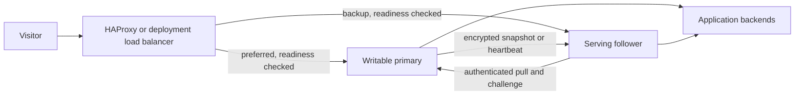

# Multi-instance design

EmberGate uses one writable primary with read-only serving followers. This design
supports live route/TLS replication and gateway traffic failover. It does not
perform distributed writer election. See the [operator guide](administration.md#multiple-instances)
for setup, promotion, stale limits, and the Compose example.

| State | Ownership |
| --- | --- |
| Routes and trusted proxies | Primary writes; followers receive the complete validated configuration |
| TLS certificates and private keys | Primary manages/renews; followers receive and activate records live |
| Accounts, MFA, passkeys, sessions | Independent per installation |
| Analytics, logs, alerts, notification/Cloudflare credentials | Independent per installation |
| Templates, history, scheduled/manual archives | Independent per installation |
| Synchronization role, peer, token | Local private management database; included in encrypted backups |
| Instance ID and generation/receipt/journal files | Local operational state; excluded from full backup archives |

The primary creates a monotonically increasing durable generation when the route
or certificate fingerprint changes. Each pull supplies a fresh UUID challenge and
its last received generation/fingerprint. The primary returns either a full
snapshot or a small unchanged-state heartbeat. Both are AES-256-GCM envelopes
bound to the protocol and the request challenge. The transport also uses a shared
256-bit bearer token and verifies HTTPS when configured. Tokens are never returned
by status endpoints; rotation returns a newly generated value once.

The follower checks the pinned primary ID, challenge, protocol, timestamp,
generation, fingerprint, route validation, and certificate/key pairs. It writes a
private roll-forward journal before replacing fixed local files. The runtime
publishes certificates before routes, clears cache epochs, and records success
only after persistence succeeds. Startup finishes an interrupted replication
journal before applying an independently queued full restore. No network-supplied
paths or SQLite databases are accepted by replication.

| Failure | Behavior |
| --- | --- |
| Invalid token, TLS error, timeout, redirect, malformed or oversized data | Keep the last validated in-memory state; record an error |
| Wrong primary, replayed challenge, stale timestamp, older generation, same generation with different content | Reject the response |
| Interrupted local snapshot persistence | Keep the journal; replay its validated fixed-file replacement on restart |
| No fresh verified heartbeat before the stale limit | Readiness and proxy traffic return 503 |
| Primary unavailable while a follower lease remains valid | Load balancer can send traffic to the synchronized follower |
| Follower process restarts | It must obtain a fresh verified heartbeat before accepting traffic |
| Primary token rotates | Old followers fail authentication and eventually become stale until updated |
| Operator promotes a follower | Fence the old writer first; configure the promoted node's renewal credentials and rejoin peers explicitly |

The load balancer and network must enforce the intended deployment boundary.
TLS pass-through preserves end-to-end encryption but does not inject HTTP visitor
identity headers. HAProxy's HTTP frontend overwrites forwarding headers; trust only
its controlled network when enabling that identity source. The supplied single
HAProxy container is an example entry point, not a redundant load-balancer cluster.

The integration check covers two real gateways and a real HAProxy process,
including TLS activation/replacement, token rotation, independent accounts,
follower write rejection, restart receipts, stale gating, and traffic failover.
A separate Compose check exercises the shipped configuration with isolated nodes,
ports, and volumes. Unit checks cover AEAD tampering/wrong-key rejection and
interrupted-journal recovery.
