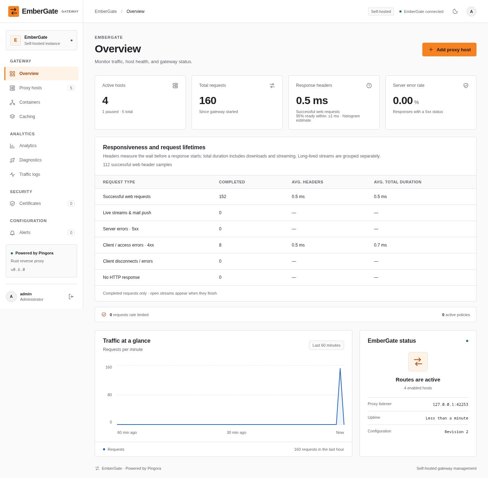

# Installation and first run

[Documentation index](README.md) · [EmberGate overview](../README.md)

## Run locally

Install a current stable Rust toolchain (at least 1.89 for the locked dependencies), a C/C++ build toolchain, CMake, pkg-config, Perl, and OpenSSL development headers. Pingora targets Linux; see [its build requirements](../pingora/README.md).

On Debian/Ubuntu, the native packages are:

```sh
sudo apt-get install build-essential pkg-config libssl-dev cmake clang
```

On Arch/Garuda:

```sh
sudo pacman -S --needed base-devel cmake clang openssl perl
```

If this terminal was open before Rust was installed, load its shell environment first with `source "$HOME/.cargo/env"` in Bash, or `source "$HOME/.cargo/env.fish"` in Fish.

Clone this repository with `git clone --recurse-submodules https://github.com/karlocizma/EmberGate.git`. For an existing checkout, run `git submodule update --init --recursive` from the repository root. Pingora is pinned as a submodule; a source ZIP alone does not include its source.

From the repository root:

```sh
cd gateway
cargo run --locked
```

Open **http://127.0.0.1:9090**. On a fresh installation, the terminal prints a **one-time setup code**. Enter it on the setup page, choose an administrator password of at least 12 characters, and confirm it. Your username is **admin**. Setup saves an Argon2 hash in the existing local SQLite database and signs you in; future launches use that saved account. An incomplete setup gets a new code on restart. Setup closes once the administrator exists, and simultaneous setup submissions cannot create or overwrite a second administrator. No database server or frontend installation is needed.



Existing environment-based installations still work. **GATEWAY_ADMIN_PASSWORD** is an optional runtime recovery override; its hash seeds the saved admin account if that account does not exist. To switch an existing installation to WebGUI password management, first run this version once with your current admin variable, stop it, then remove that variable and restart. Your original password now works from the saved account. In Fish, use `set --erase GATEWAY_ADMIN_PASSWORD`; in Bash, use `unset GATEWAY_ADMIN_PASSWORD`. Also remove any persisted setting from shell startup files or your service configuration so it is not restored on the next launch. While an override is active, the UI explains why password changes are disabled.

The proxy listens on **127.0.0.1:8080**. The application executable is now `embergate`; update any external service command that still launches `pingora-gateway`.

For a first upstream, run this in another terminal:

```sh
python3 -m http.server 9000 --bind 127.0.0.1
```

Select **Add proxy host** in the dashboard and enter the destination:

| Field | Value |
| --- | --- |
| Name | Local website |
| Public domain | app.localhost |
| Application address | http://127.0.0.1:9000 |

Continue to **Access**, leave **Allow HTTP** selected for this local example, then review and create the host. The public path defaults to `/` and new hosts start active; both can be changed under **Advanced settings**.

Then send traffic:

```sh
curl -H 'Host: app.localhost' http://127.0.0.1:8080/
```

The dashboard updates every five seconds. Active means a route is enabled. When health checks are configured, the dashboard shows verified backend health and pool availability separately.
## Docker

GitHub Actions builds, tests, and publishes the Linux amd64 image to `ghcr.io/karlocizma/embergate`. Clone the repository to get the deployment files; prebuilt images require no submodules or compiler on the server:

```sh
git clone https://github.com/karlocizma/EmberGate.git
cd EmberGate
cp .env.example .env
# Edit .env before starting the containers.
docker compose pull
docker compose up -d --no-build
docker compose logs gateway
```

A plain `git clone` is sufficient for this deployment; `--recurse-submodules` is only needed when building from source. Alternatively, download just [compose.yaml](../compose.yaml) and [.env.example](../.env.example) into a deployment directory and start with the `cp` command above.

Use the setup code from the logs to create the administrator in the browser. The admin password environment variable is optional. If provided, it acts as the same recovery override described above.

Repeat `docker compose pull` and `docker compose up -d --no-build` to update. Existing named volumes are retained. The `latest` tag tracks successful builds of `main`; Git tags beginning with `v` also publish the matching image tag. Only `latest` and release tags are published; the source commit remains recorded in the image revision label. Pin a release in `.env`, for example `EMBERGATE_IMAGE=ghcr.io/karlocizma/embergate:v0.7.4` once that release exists. To roll back, select a previous image tag and run the same pull/start commands.

After the first workflow publication, make the package public in GitHub's package settings to allow anonymous pulls. If you keep it private, first run `docker login ghcr.io -u YOUR_GITHUB_USERNAME` with a personal access token (classic) with `read:packages` and access to the package.

To expose containers from the dashboard, use [docker-discovery-compose.yaml](../deploy/docker-discovery-compose.yaml) instead; see [Docker containers](proxy.md#docker-containers).

For the two-node example, download both [cluster-compose.yaml](../deploy/cluster-compose.yaml) and [haproxy.cfg](../deploy/haproxy.cfg) into the same directory, then run `docker compose -f cluster-compose.yaml up -d --pull always --no-build`. Both gateway services use `EMBERGATE_IMAGE` in the same way.

To build from source instead, initialize the Pingora submodule as described above, run `docker build -t embergate:local .` from the repository root, then run `EMBERGATE_IMAGE=embergate:local docker compose up -d --no-build`.

Docker publishes HTTP on host port **80**, HTTPS on **443**, and the management dashboard on **9090**. Container ports remain 8080, 8443, and 9090 respectively. Compose uses plain `80:8080`, `443:8443`, and `9090:9090` port mappings, so Docker publishes them on the host's network interfaces. Open the dashboard at `http://YOUR_SERVER_IP:9090`. Allow access through the VM firewall and restrict admin port 9090 to your trusted network. The VM network must be reachable from your LAN. Routes persist in the `gateway-data` volume. Inside a container, `127.0.0.1` refers to that container: use a reachable upstream address or another Compose service name.

EmberGate uses a five-second drain window for SIGTERM shutdowns, followed by up to two seconds of runtime cleanup. Compose allows 15 seconds before forcing termination. Recreating the container therefore stops waiting through Pingora’s old five-minute default. Short requests can finish during the drain; longer downloads, mail push, WebSockets and other streams may be interrupted and need to reconnect. Ctrl+C (SIGINT) stops the local process immediately. The first update from an older image still uses that older process’s shutdown settings; subsequent restarts use the shorter window. Pull the updated Compose file as well to use its 15-second stop limit.
