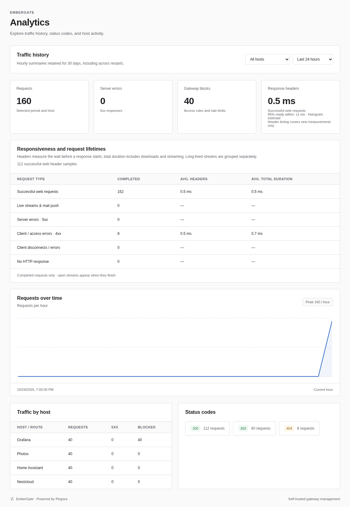

# Monitoring and diagnostics

[Documentation index](README.md) · [EmberGate overview](../README.md)

## Persistent analytics

Open **Analytics** for hourly charts, totals, average duration, status-code counts, and traffic by route. Choose **24 hours**, **7 days**, or **30 days**, and optionally select one current or historical route. The selected period includes the current partial hour. Historical traffic remains visible after a route is removed. Unmatched requests are tracked separately. Gateway blocks count access denials and gateway rate limits, while 5xx counts server errors. An upstream's own 403/429 response is counted by status without being classified as a gateway block.



The database is **analytics.sqlite3** in GATEWAY_DATA_DIR. It uses SQLite WAL transactions, full synchronous commits, and Unix permissions 0600. A dedicated writer keeps SQL off proxy workers and batches queued records, with a 4096-command bound and backpressure instead of silent drops. Storage write failures are logged and retried; analytics queries time out with a service error if storage cannot respond. The newest queued/uncommitted records can be lost during a forced process stop; committed transactions survive restart. Existing in-memory history from an older gateway version cannot be recovered retroactively.

Hourly aggregates and status counts are retained for 30 days. At most 10000 recent request records are stored within that retention period; **Traffic logs** shows the latest 200, now including verified visitor IP, connection peer, source, and policy outcome. Query strings, request bodies, cookies, and authorization headers are not stored. IP addresses and paths are retained locally, so protect/back up the data directory accordingly. Retention cleanup runs on startup and during activity; the SQLite file can retain reusable free space after rows expire. Stop the gateway before copying its data directory, including any SQLite WAL files, for a filesystem backup.

The overview intentionally keeps its since-start counters and 60-minute chart. Use **Analytics** for durable history. Route exports contain configuration only, including trusted proxies and per-route policies; the analytics database is separate. The authenticated API is `/api/analytics?hours=24&route_id=<uuid>` (omit route_id for all traffic; use `unmatched` for unmatched requests). `/api/logs` returns the latest persisted request records.
## Diagnostics

Open **Diagnostics** in the sidebar, or use the magnifying-glass action on a proxy host. Choose a saved host or enter a visitor hostname (optionally with its port) and a URL path. For a wildcard host, replace the example hostname with the actual visitor hostname you want to inspect.

**Check routing** takes a snapshot of the current configuration and shows the same exact-host/wildcard/longest-prefix match used by the proxy, the rewritten upstream path, paused matches excluded from routing, the Host-header policy, and the configured traffic timeouts. It also shows the currently valid certificate selected for that visitor hostname and whether the HTTPS listener is enabled. This preview sends no network requests.

**Run backend checks** resolves and checks every saved origin on the matched active route, including draining origins. Each backend card shows resolved addresses, the selected address, separate DNS/TCP/TLS/HTTP timings, the sent Host header, and the last monitored health status. HTTPS checks verify the certificate chain and the origin hostname with OpenSSL's configured trust store; successful checks show certificate expiry and days remaining. Upstream SNI uses the origin hostname even when the HTTP Host header preserves the visitor hostname.

A probe sends **HEAD** over a new HTTP/1.1 connection to the rewritten path, retaining the original query and configured request-header overrides/removals. It copies no dashboard cookies or authorization headers, follows no redirects, sends no body, and reads only response headers. A 4xx/5xx response means the backend responded with an application error; 405 may mean the application does not support HEAD. DNS resolution uses the first returned address, matching the proxy's current selection. The preview hostname chooses a saved route; it never becomes an arbitrary outbound target.

Probes bypass visitor IP access rules, rate limits, HTTPS redirects, maintenance responses, and the response cache. Notes call out those policies so the report is not mistaken for a complete visitor request test. Diagnostics do not update monitored backend health, balancing activity, proxy traffic counters, analytics, or logs. HEAD requests can still appear in the upstream application's own logs. Route names, notes, and diagnostic values are rendered as escaped text.

Diagnostic limits are separate from traffic timeouts: **3 seconds DNS, 5 seconds TCP, 5 seconds TLS, and 5 seconds HTTP**, with **two reports and four backend connections** running at once. Each report has a **30-second deadline** and a 16 KiB/64-header response limit. When the report deadline is reached, completed backend results remain available and a note identifies unfinished checks. A report marks configuration changes made during its run. Long probes do not block management saves, and routing/probing remains available while a full restore is queued.

The **POST /api/diagnostics** endpoint accepts `{ "host": "app.example.com", "path": "/health", "probe": false }` (use `true` for backend checks). It requires an administrator session, any enforced two-factor enrollment, and `X-Gateway-Request: 1`. Diagnostic actions are audited without saving request bodies, queries, credentials, or response headers. Read-only accounts cannot run diagnostics; reports are transient and are cleared on logout.
## Alerts and webhook delivery

**Alerts** monitors enabled backend health checks, certificate issuance/renewal and DNS cleanup failures, and the proxy's recent 5xx rate. Checks run about every ten seconds. The default traffic threshold is 10% with at least 20 requests in a five-minute window; preferences allow 1–100%, 1–100,000 minimum requests, and 1–60 minutes. Traffic monitoring uses minute buckets and starts fresh on restart. Pending backend probes and queued/issuing certificate retries preserve existing alerts until the condition is known again.

Active alerts persist across restarts and are deduplicated by condition. Acknowledge an alert to mark it reviewed; it stays active until recovery. A fresh failure after recovery creates a new alert. Disabling a monitoring category resolves its active alerts. The dashboard shows up to 200 active/recent alerts; resolved history is retained for 90 days or 1,000 entries. Active alerts are retained independently.

Dashboard monitoring works without an external service. In **Alerts**, choose **Discord** or **Generic JSON webhook**, paste the webhook URL under **Webhook destination**, and save it. Then enable webhook delivery and **Save preferences**. Saving a destination saves its selected format but does not itself send a test. **Send test notification** explicitly queues a test. Administrators can change/remove destinations; read-only users can view status. The URL is never returned to browsers or audit logs and is stored unencrypted in the private management database. HTTPS is required; HTTP is accepted only for loopback fixtures. URL credentials, fragments, whitespace, and URLs over 2048 bytes are rejected.

**GATEWAY_ALERT_WEBHOOK_URL** remains an optional server override. It takes precedence over the saved destination and disables browser URL editing until removed and the server restarted. The notification format is still chosen in Alerts; old saved preferences default to generic JSON. Docker Compose already passes the optional environment variable through.

Discord uses incoming webhook URLs such as `https://discord.com/api/webhooks/ID/TOKEN`, with optional numeric `thread_id` for an existing thread. Messages contain an EmberGate embed, opened/recovered/test status, timestamp, and alert identifier where available. Mentions are disabled, and text is capped to fit the payload. Requests set `wait=true` to request confirmation. Supported Discord hosts are discord.com, canary.discord.com, and ptb.discord.com; local fixtures are also allowed. See the [official Discord webhook documentation](https://docs.discord.com/developers/resources/webhook#execute-webhook).

Generic receivers continue to receive JSON containing an `event` of `opened`, `resolved`, or `test`, a timestamp, and an alert object with identifier, source, title, and message. Tests use a simple message instead. Raw certificate errors, account credentials, and request data are excluded; configured service names and backend origins may appear. Email notification formatting is not implemented.

HTTP redirects and environment HTTP proxies are disabled. A 2xx response counts as delivered. Network/non-2xx failures retry up to five total attempts with 30/60/120/240-second delays and a ten-second request timeout. A numeric HTTP 429 Retry-After can extend a delay, bounded to one day. Response bodies and webhook URLs are never logged. Delivery is at least once: a lost response or crash after acceptance may produce duplicates. Generic receivers can deduplicate by alert identifier/event; Discord embeds include that identifier for reference. See [Discord rate-limit behavior](https://docs.discord.com/developers/topics/rate-limits).

Enabling delivery sends future transitions rather than replaying old alerts. Disabling delivery, changing its format, or replacing/removing the destination cancels pending messages; a request already in flight may finish. Removing a saved destination also disables delivery. The durable queue holds at most 1,000 pending messages and about 1,000 recent completed rows. Failed delivery counts remain visible. An absent environment destination pauses delivery if no saved URL is available.
## Prometheus metrics

In **Alerts → Prometheus metrics**, select **Generate scrape token**. Copy the token before clearing it; it is returned only on generation and its SHA-256 hash is stored in the management database. Machine scrapes use **GET /metrics** on the management listener with `Authorization: Bearer TOKEN`. Scraping is disabled until a token exists. Rotate it to revoke the previous token immediately, or disable scraping to revoke it entirely. Tokens persist across restarts. Administrator controls require an authenticated session and request verification; read-only users cannot generate or revoke tokens. **View metrics** uses the session-protected **GET /api/metrics**, also available to read-only accounts.

The exporter emits [Prometheus text format 0.0.4](https://prometheus.io/docs/instrumenting/exposition_formats/). Configure Prometheus with a local token file, for example:

```yaml
scrape_configs:
  - job_name: embergate
    scrape_interval: 15s
    metrics_path: /metrics
    authorization:
      type: Bearer
      credentials_file: /etc/prometheus/embergate.token
    static_configs:
      - targets: ['127.0.0.1:9090']
```

Put only the generated token in that file and restrict access to it. The example assumes both processes share a local network namespace. For a separate host/container, use its reachable management address; use HTTPS through your management reverse proxy for remote scrapes. The exporter adds no new listener. See the [Prometheus scrape configuration reference](https://prometheus.io/docs/prometheus/latest/configuration/configuration/#scrape_config).

| Metrics | Meaning |
| --- | --- |
| `embergate_requests_total`, `embergate_errors_total` | Completed proxy requests and 5xx responses; management traffic/scrapes are excluded. |
| `embergate_http_responses_total` | Requests by a bounded method and status-class vocabulary. Unknown methods use OTHER. |
| `embergate_request_duration_seconds`, `embergate_route_request_duration_seconds` | Global/per-route cumulative latency histograms, including cache hits and gateway responses; buckets from 5 ms to 10 s plus infinity. |
| `embergate_route_requests_total`, `embergate_route_errors_total` | Per-route request and 5xx totals. |
| `embergate_rate_limited_requests_total`, `embergate_access_denied_requests_total`, `embergate_maintenance_requests_total` | Gateway policy responses, including 200 maintenance holding pages. |
| `embergate_upstream_attempts_total`, `embergate_failovers_total` | Actual upstream attempts and additional distinct-backend attempts. |
| `embergate_uptime_seconds`, `embergate_config_revision`, `embergate_routes` | Process uptime, configuration revision, and configured route count. |
| `embergate_route_enabled`, `embergate_route_maintenance` | Current route state. |
| `embergate_backend_available`, `embergate_backend_active_requests`, `embergate_backend_draining`, `embergate_backend_weight` | Current backend eligibility, activity, drain state, and weight. Availability excludes maintenance, paused routes, draining origins, and unhealthy/pending checked backends. |
| `embergate_cache_used_bytes`, `embergate_cache_capacity_bytes`, `embergate_cache_entries` | Shared-cache storage gauges. |
| `embergate_cache_hits_total`, `embergate_cache_misses_total`, `embergate_cache_bypasses_total`, `embergate_cache_purges_total`, `embergate_route_cache_bytes` | Per-route cache counters/storage. |
| `embergate_certificate_days_remaining` | Whole days remaining for installed certificates, negative after expiry. |
| `embergate_active_alerts`, `embergate_notification_queue` | Unresolved alerts and retained outbox rows by pending/delivered/failed/cancelled state. Queue counts are gauges, not lifetime delivery counters. |

Labels use configured route/certificate UUIDs and zero-based backend indexes in origin order. Metrics exclude hostnames, origin URLs, paths, query strings, client IPs, usernames, headers, and secrets. Cardinality is bounded by the validated configuration and fixed method/status vocabularies. Route IDs can be mapped through the dashboard or authenticated configuration API. Process traffic counters/histograms reset on restart; per-route counters disappear when a route is removed. Cache counters can reset when a cache policy is removed/re-created. Storage/queue gauges reflect current retained state; scrapes take sequential snapshots rather than a transaction across all components. Use `rate()`/`increase()` for counters.

The dashboard now separates response readiness from connection lifetime. The main
**Response headers** card shows average time from request start until final response
headers are ready for successful web requests, plus an approximate p95 upper bound
from fixed histogram buckets (1 ms through 120 seconds). This is measured at the
gateway, not at the browser, and includes request upload, authentication and upstream
waits. It is not a measurement of proxy overhead alone. Total duration includes body
transfer, downloads and streaming.

A separate table groups successful web requests, identified live streams / mail push,
5xx responses, 4xx responses, client disconnects / downstream errors, and requests
without an HTTP response. ActiveSync, native gRPC, WebSocket upgrades and event-stream
responses are identified; other long-poll endpoints may remain in web requests.
A disconnected stream can retain its original HTTP 200 status in the access log
while belonging to the disconnect group. Disconnect grouping does not identify intent.

Only completed requests are included; currently open streams appear after completion.
Overview covers the current process lifetime; Analytics follows the selected host and
period. Header measurements start with this update; older totals remain intact.
A dash means no samples. Logs retain both `header_latency_ms` and full `latency_ms`.
The stats API and historical totals expose the new `timing` groups alongside the
existing averages for compatibility. Histograms are merged by sample counts.
